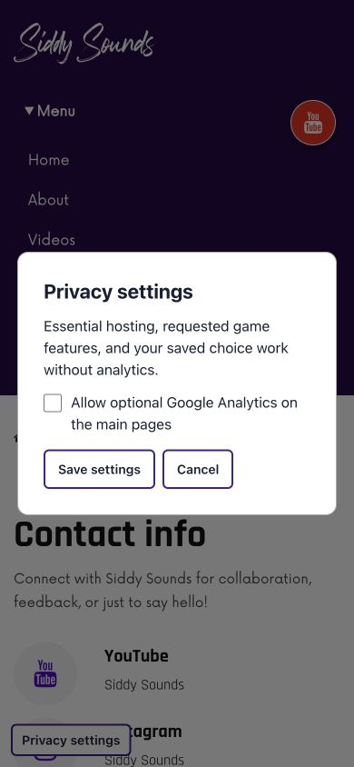

# SiddySounds website audit — 12 November 2026

The audit covers all 44 original HTML pages, including 30 games, their linked CSS/JavaScript, and shared assets. A recovery page brings the updated total to 45 HTML pages. Changes are prepared in GitHub for review; this report does not assert deployment or universal legal compliance.

## Fixes

| Area | Verified problem | Change |
|---|---|---|
| Performance | Full-page load overlay, heavy scripts everywhere, 100 Hz player polling | Immediate rendering, selective ordered scripts, accessible native audio with no preloading |
| Images | Large PNG/JPEG assets | 17 WebP alternatives; original files retained |
| Fonts/CSS | CSS discovery waterfall, missing theme file, external main font request | Direct styles, local Rajdhani with OFL notice, font-display swap, missing references removed |
| Contact | Duplicate form IDs, broken mailto template, footer implied a newsletter backend | Single labelled form that opens an email app; honest contact link in footer |
| Privacy | Analytics and Clarity loaded before a choice; opt-out banner did not block them | Local explicit opt-in; reject/settings; 180-day choice; withdrawal cleanup/reload; cross-tab withdrawal; GPC/DNT respected; Clarity and advertising removed |
| Policies | Generic cookie categories, analytics incorrectly called non-personal, browsing implied consent | Notices describe hosting, optional analytics, actual storage, providers, email, games, permissions, retention, rights and complaints |
| Legacy pages | Exposed experimental Firebase chat; stale tracking and broken feeds | backup.html and indexold.html redirect to home; blogold.html redirects to blog; source history remains in Git |
| Video/blog | Malformed YouTube query strings and unsafe/unhandled blog feed content | External main video links; 11 actual YouTube videos verified via oEmbed; text-only excerpts, timeout/error state and Blogger fallback |
| Games | Missing Flappy stylesheet; mixed-content assets; invalid random index; failed timers, leaked insects, incorrect 2048 rules | Correct references/HTTPS, cleanup, bounded spawning, event-driven 2048 rules, quote game works offline, typed speech-game fallback, permission only on request |
| Mobile | Eleven game layouts overflowed at 390 px | Responsive boards, canvas sizing, controls and game bounds; all repaired layouts rechecked |
| Accessibility | Unnamed icon links, missing alternatives/focus, JS-dependent menu | Labels, native mobile menu, skip links, proper headings, focus states, reduced-motion handling, native audio controls |
| SEO/recovery | Every canonical URL pointed to home; sitemap used /tracks; policies blocked by robots | Per-page canonical/share metadata, corrected sitemap, crawlable policies and custom 404 |
| Maintenance | No site regression checks; template security policy | Dependency-free structural checker, Node consent/game/syntax tests, CI workflow, real security-report contact |

## Measured asset reduction

The 17 optimized images total **13,396,279 → 1,833,984 bytes** (about 86.3% smaller). This is an asset-size comparison, not a Lighthouse score or a claim that every page loads that percentage faster. The hero alone is 1,704,155 → 33,688 bytes.

## Broken and uncertain URLs found

| Original URL/reference | Observed result | Resolution |
|---|---|---|
| css/owl.theme.default.min.css (eight main pages and old reference CSS) | Missing repository asset | Removed unused reference |
| css/owl.video.play.png | Missing repository asset | Replaced obsolete icon background |
| Flappy Bird styles.css | Missing; actual file is style.css | Corrected |
| backup.html: firebase_script.js, config.js | Wrong root paths | Legacy page redirects to current home |
| indexold.html: icon.png, google_analytics.js, weather_script.js, firebase_script.js, your-profile-image.webp | Missing root paths | Legacy page redirects to current home |
| https://www.twitter.com/siddysounds | 404 after redirect to X | Retired legacy link; active site uses imsidsuri |
| https://www.snapchat.com/add/siddysounds | 404 | Retired legacy link; active site uses imsidsuri |
| https://sidxsuri.blogspot.com/feeds/posts/default?alt=json-in-script&callback=fetchBlogPosts | 404 | Retired legacy feed; current blog uses siddysounds.blogspot.com |
| https://www.sidxsuri.com | Fetch failed; not established as a confirmed 404 | Removed stale canonical through legacy redirect |
| https://codepen.io/steveg3003/pen/zBVakw | 403; page URL used as a JavaScript file | Removed invalid script dependency |
| https://www.linkedin.com/in/siddysounds | 999 automation block; existence not established | No active page links to it after legacy redirect |
| https://medium.com/@siddysounds | 403 automation block; not a confirmed dead profile | No active page links to it after legacy redirect |

Final inventory: all 71 remaining static external HTML/CSS destinations returned HTTP 200 in this check. All 11 YouTube video IDs returned successful oEmbed metadata. HTTP success does not prove account ownership, regional availability, future availability, or correctness of all third-party content. The fonts.gstatic.com preconnect root returning 404 was not a broken asset.

## Verification and practical limits

- Structural checks passed for all 45 updated HTML pages: local files, CSS URL targets, manifest icons, duplicate IDs, UTF-8, image alternative attributes, unconditional tracking tags and canonical URLs.
- Five Node regression groups passed: default-denied/blocked-storage/invalid consent; accept-once and withdrawal; rejected/expired/browser-signalled consent; 2048 merge/score cases; syntax for all JS and executable inline scripts. Locally run using the Node runtime with the same test callbacks; CI runs node --test directly.
- Browser smoke checks visited all main/standalone pages, all 30 games, three legacy redirects and 404. No console errors were observed during the initial game/page checks. This does not certify every possible gameplay path.
- Main pages/standalone pages and all games were inspected at 390×844; eleven overflowed game layouts were repaired and rechecked. Desktop pages and mobile navigation were also checked.
- Rejected consent produced no Analytics/Clarity/advertising script elements in browser checks. Settings could be reopened with the optional checkbox off. Typed number guessing and an actual 2048 keyboard move were tested. Microphone and personal geolocation permission were not granted, no email was sent, and real analytics events were not intentionally generated.
- No live Lighthouse/CrUX benchmark, penetration test, exhaustive media playback run, email delivery test, or authenticated provider-console audit was performed.

## Owner actions that code and policy wording cannot complete

1. Confirm rights/licenses for all music, artwork, game code/assets and the existing Now/Rockville fonts. Existing author credits are retained; a credit alone does not establish permission. Rajdhani's OFL file is included and vendor license headers are preserved.
2. Verify Firebase rules prevent unauthorized writes and expose only intended public records. Removing the experimental chat page does not change the Firestore database rules or erase data already stored there.
3. Review Google Analytics retention, account/property access, any linked advertising products and provider agreements. The code disables advertising features, but cannot inspect console-side settings or delete historical data.
4. Confirm the contact mailbox is monitored and implement the enquiry-retention/privacy-request process described in the notice. A policy is a commitment to practices, not a liability waiver.
5. The weather repair uses Open-Meteo's public API with attribution and only on request. Its free endpoint is restricted to non-commercial use; confirm eligibility for this personal site before publishing that feature. If used for commercial promotion/monetization, use an appropriate paid/provider-approved arrangement instead. No subscription was purchased.
6. The previous weather API credential was public in the repository. It is no longer used in current source; consider revoking/rotating it with the old provider because Git history remains.
7. Have a qualified adviser review applicability of privacy/consumer/content laws and the final notice where needed. The India's DPDP commencement notification phases provisions over time; this update makes no blanket claim that every provision applies today or that the site complies with all jurisdictions.

## Reference sources checked

- ICO: https://ico.org.uk/for-organisations/advice-for-small-organisations/privacy-notices-and-cookies/how-to-write-a-privacy-notice-and-what-goes-in-it
- ICO consent practice: https://ico.org.uk/for-organisations/direct-marketing-and-privacy-and-electronic-communications/guidance-on-the-use-of-storage-and-access-technologies/how-do-we-manage-consent-in-practice
- GA4 cookie details: https://support.google.com/analytics/answer/11397207?hl=en
- GitHub Pages data collection: https://docs.github.com/en/pages/getting-started-with-github-pages/what-is-github-pages
- Open-Meteo terms: https://open-meteo.com/en/terms
- India DPDP commencement: https://www.meity.gov.in/static/uploads/2025/11/c56ceae6c383460ca69577428d36828b.pdf

## Browser previews

